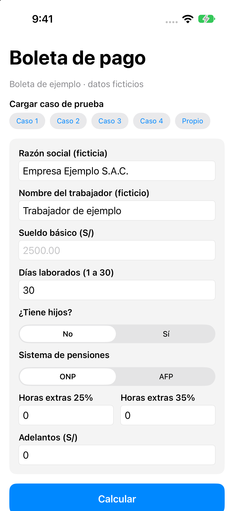
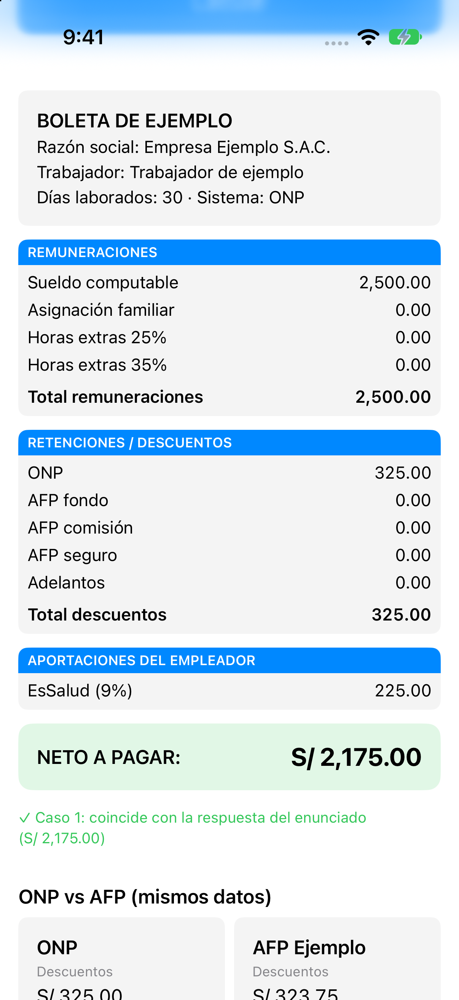
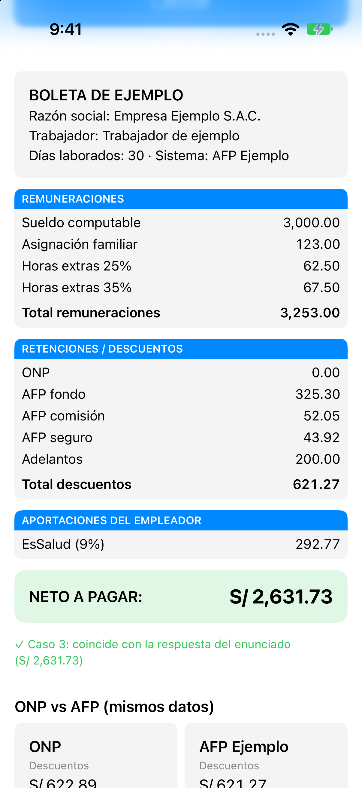
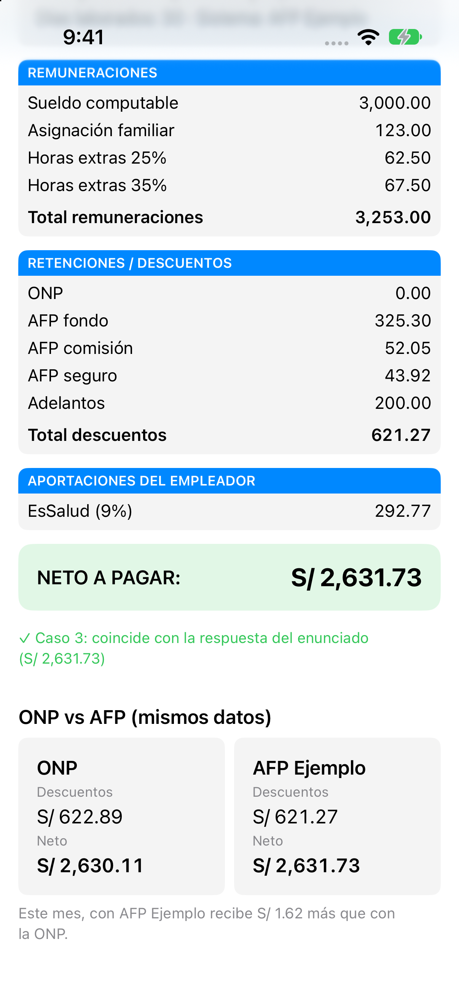
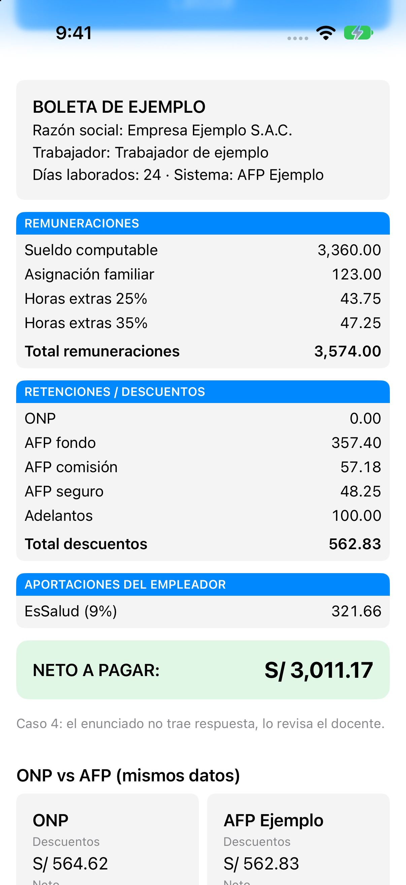
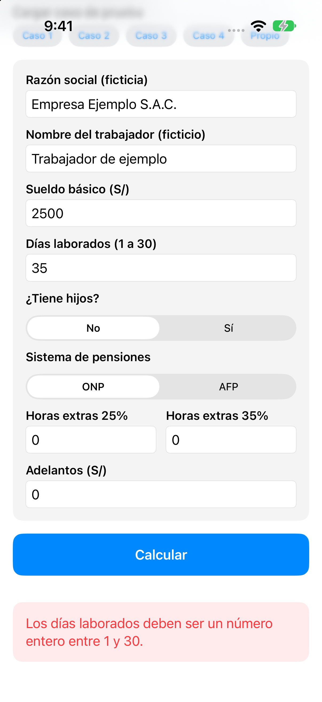

# Laboratorio 09 · Boleta de pago: del sueldo al neto

**Curso:** Programación en Móviles Avanzado · Semana 09: Diseño de interfaces gráficas con SwiftUI
**Alumno:** Harold Salvador Zarate
**Rama:** `BoletaPago_Lab09`

App de una sola pantalla en **SwiftUI** donde el usuario ingresa los datos del mes, pulsa **Calcular** y ve la boleta con sus tres bloques (Remuneraciones, Retenciones / Descuentos y Aportaciones del empleador) y el **Neto a pagar**. La acompaña un libro de **Excel** con fórmulas visibles que explica y valida cada cálculo.

> Boleta de ejemplo: todos los nombres de personas y empresas son ficticios.

## Capturas

| Formulario | Caso 1 (ONP) | Caso 3 (AFP) |
|---|---|---|
|  |  |  |

| ONP vs AFP (reto) | Caso 4 | Validación |
|---|---|---|
|  |  |  |

## Estructura del proyecto

```
Semana09_BoletaPago/
├── Semana09_BoletaPago.xcodeproj
├── Semana09_BoletaPago/
│   ├── Semana09_BoletaPagoApp.swift   → punto de entrada (@main)
│   ├── Parametros.swift               → constantes (RMV, ONP, EsSalud…) y diccionario de tasas AFP
│   ├── Modelos.swift                  → structs: DatosTrabajador, Concepto, Encabezado
│   ├── Boleta.swift                   → clase Boleta: hace todo el cálculo
│   ├── Validacion.swift               → convierte y valida lo que se escribe en el formulario
│   ├── CasosPrueba.swift              → array con los casos 1 a 4 y el caso propio
│   ├── ContentView.swift              → pantalla única: formulario + botón Calcular
│   ├── BoletaView.swift               → los tres bloques de la boleta y el neto
│   └── ComparacionView.swift          → reto: ONP y AFP lado a lado
├── Excel/Boleta_de_pago_Lab09.xlsx    → hojas Parámetros, Boleta, Casos y Explicación
└── capturas/
```

**El modelo está separado de la pantalla.** Las vistas solo muestran datos. El cálculo vive en la clase `Boleta`, que recibe un `DatosTrabajador` (struct) y devuelve arrays de `Concepto` para cada bloque. Las tasas de las AFP están en un diccionario `[String: TasasAFP]`.

**Controles usados:** `Text`, `VStack`, `HStack`, `@State`, `TextField`, `Picker`, `Button` y `ScrollView`, que es el único control nuevo.

## Reglas de cálculo

| Concepto | Cómo se calcula |
|---|---|
| Sueldo computable | Sueldo básico ÷ 30 × días laborados |
| Asignación familiar | 10% de la RMV si tiene hijos (no se prorratea) |
| Valor hora | Sueldo básico ÷ 30 ÷ 8 |
| Horas extras 25% / 35% | Valor hora × 1.25 (o 1.35) × horas |
| ONP | 13% del total de remuneraciones |
| AFP | Fondo + comisión + seguro, cada uno sobre el total de remuneraciones |
| Neto a pagar | Total remuneraciones − total descuentos |
| EsSalud | 9% del total de remuneraciones (lo paga el empleador) |

Cada concepto se redondea a 2 decimales y luego se suman. En Swift se usa `Decimal` en lugar de `Double` para que los centavos salgan exactos: por ejemplo, 43.9155 se redondea a 43.92, igual que `REDONDEAR` en Excel.

## Validaciones

| Dato | Regla | Mensaje |
|---|---|---|
| Sueldo básico | Mayor que cero | "El sueldo básico debe ser un número mayor que cero." |
| Días laborados | Entero entre 1 y 30 | "Los días laborados deben ser un número entero entre 1 y 30." |
| Horas extras | Mayor o igual a cero | "Las horas extras al 25% deben ser un número mayor o igual a cero." |
| Adelantos | Mayor o igual a cero | "Los adelantos deben ser un monto mayor o igual a cero." |

Si algún dato no es válido, la app muestra el mensaje en rojo y no calcula.

## Control cruzado: app vs Excel

| Caso | Datos | Neto en la app | Neto en Excel | Neto del enunciado | ¿Coincide? |
|---|---|---:|---:|---:|---|
| 1 | S/ 2,500 · 30 días · sin hijos · ONP | 2,175.00 | 2,175.00 | 2,175.00 | ✅ |
| 2 | S/ 1,800 · 27 días · con hijos · ONP | 1,516.41 | 1,516.41 | 1,516.41 | ✅ |
| 3 | S/ 3,000 · 30 días · con hijos · AFP Ejemplo · 4 h 25% · 4 h 35% · adelanto 200 | 2,631.73 | 2,631.73 | 2,631.73 | ✅ |
| 4 | S/ 4,200 · 24 días · con hijos · AFP Ejemplo · 2 h 25% · 2 h 35% · adelanto 100 | 3,011.17 | 3,011.17 | (lo revisa el docente) | ✅ |
| Propio | S/ 1,700 (oferta real) · 30 días · sin hijos · AFP Habitat | 1,481.72 | 1,481.72 | — | ✅ |

Detalle del **caso 4**: sueldo computable 3,360.00 · asignación 123.00 · HE 25% 43.75 · HE 35% 47.25 · total remuneraciones 3,574.00 · AFP fondo 357.40 · comisión 57.18 · seguro 48.25 · adelantos 100.00 · total descuentos 562.83 · **neto 3,011.17** · EsSalud 321.66.

## Niveles de avance

- **Nivel 1:** sueldo, días laborados, asignación familiar, ONP, EsSalud y neto. Casos 1 y 2 verificados.
- **Nivel 2:** AFP en lugar de ONP, horas extras y adelantos. Casos 3 y 4.
- **Nivel 3 (reto):** encabezado con trabajador y razón social ficticios, y ONP y AFP lado a lado en la misma pantalla. La retención de renta de 5.ª categoría no se implementó.

## Preguntas de análisis

1. **ONP o AFP (caso 3).** Con AFP Ejemplo el neto es S/ 2,631.73 y con ONP es S/ 2,630.11, así que este mes la AFP deja **S/ 1.62 más**. Comparar porcentajes no basta porque no son lo mismo. En la AFP, el 10% del fondo va a una cuenta personal que gana rentabilidad. La ONP es un fondo común que paga una pensión definida si se cumplen 20 años de aportes. Además, la comisión y el seguro cambian según la AFP. Hay que pensar en la pensión futura, no solo en el neto del mes.
2. **Costo real para la empresa (caso 3).** El trabajador le cuesta a la empresa S/ 3,253.00 + S/ 292.77 de EsSalud = **S/ 3,545.77**. De ese costo, **74.22%** llega al trabajador como neto.
3. **Días laborados (caso 2).** Con 30 días el neto sería S/ 1,673.01, es decir **S/ 156.60 más**, aunque el bruto sube S/ 180.00. La diferencia es menor porque de esos S/ 180 también se descuenta el 13% de ONP (180 × 0.87 = 156.60). Además, la asignación familiar no cambia porque no se prorratea.
4. **Horas extras (caso 3).** S/ 62.50 + S/ 67.50 = S/ 130.00, que es el **4.00%** del total de remuneraciones.
5. **Con datos reales.** Para una oferta de *Asistente de TI* en Computrabajo (S/ 1,700.00), con AFP Habitat, sin hijos y el mes completo, el neto es S/ 1,481.72: llega el **87.16%** del bruto. Con ONP, el neto sería S/ 1,479.00 (87.00%). La comparación con dos compañeros está en la hoja *Explicación* del Excel.

## Tabla de fuentes

| Dato | Valor | Fuente | Fecha de consulta |
|---|---|---|---|
| RMV | S/ 1,230.00 | D.S. de la RMV, vigente desde el 1/10/2026 (enunciado) | 28/10/2026 |
| Asignación familiar | 10% de la RMV | Ley 25129 | 28/10/2026 |
| ONP | 13% | D.L. 19990 | 28/10/2026 |
| EsSalud | 9% | Ley 26790 | 28/10/2026 |
| Horas extras | Recargo de 25% y 35% | D.S. 007-2002-TR | 28/10/2026 |
| AFP Ejemplo | Fondo 10% · comisión 1.60% · seguro 1.35% | Enunciado (valores de prueba) | 28/10/2026 |
| Tasas AFP reales | Fondo 10% · comisión Habitat 1.47%, Integra 1.55%, Prima 1.60%, Profuturo 1.69% · seguro 1.37% | [SBS: comisiones y primas, devengue 2026-10](https://www.sbs.gob.pe/app/spp/empleadores/comisiones_spp/Paginas/comision_prima.aspx) | 28/10/2026 |
| Sueldo real (caso propio) | S/ 1,700.00 mensuales | [Computrabajo: Asistente de TI](https://pe.computrabajo.com/ofertas-de-trabajo/oferta-de-trabajo-de-asistente-de-ti-desarrollo-y-soporte-de-sistemas-puente-piedra-en-puente-piedra-70B2AA847863D68061373E686DCF3405) | 28/10/2026 |

## Cómo ejecutar

1. Abrir `Semana09_BoletaPago.xcodeproj` en Xcode.
2. Elegir un simulador de iPhone y pulsar ▶︎ Run.
3. Usar los botones **Caso 1 … Caso 4** y **Propio** para cargar los casos de prueba, o escribir los datos y pulsar **Calcular**.
