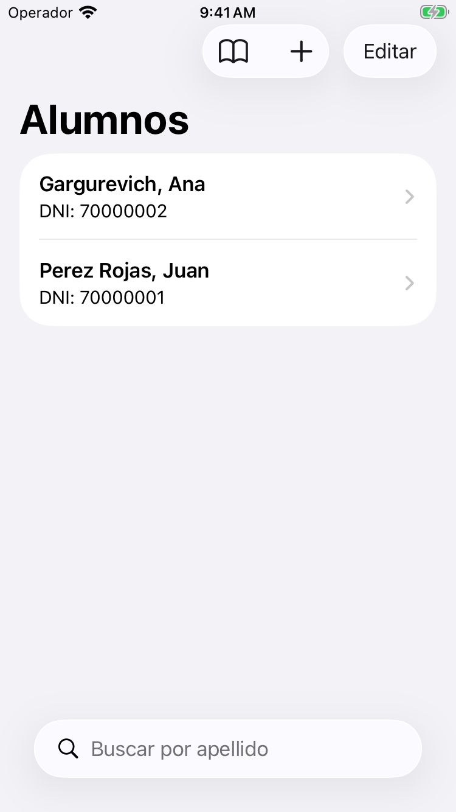

# Laboratorio 11 · Manejo de datos con Core Data y SwiftData

**Curso:** Programación en Móviles Avanzado · Semana 11
**Alumno:** Harold Salvador Zarate
**Rama:** `CoreData_Lab11`

El laboratorio resuelve el mismo problema, guardar datos en el teléfono para que no se pierdan al cerrar la app, con dos tecnologías:

| Parte | Proyecto | Tecnología | Entidades |
|---|---|---|---|
| 1 | `apple_lab11_01_UIKit_CoreData` | UIKit + Storyboard + Core Data | `Contacto` y `Grupo` |
| 2 | `apple_lab11_02_SwiftUI_SwiftData` | SwiftUI + SwiftData | `Alumno` y `Curso` |

## Capturas

| Parte 1 · Lista de Contactos (Core Data) | Parte 2 · Alumnos (SwiftData) |
|---|---|
|  |  |

## Parte 1 · Core Data con UIKit (Contacto)

- **Proyecto:** Interface *Storyboard*, Storage *Core Data*. En `AppDelegate` está el `persistentContainer`, con el mismo nombre que el archivo `.xcdatamodeld`.
- **Modelo** (hecho en el editor `apple_lab11_01_UIKit_CoreData.xcdatamodeld`, con atributos en minúscula):

| Entidad | Atributos | Relación |
|---|---|---|
| `Contacto` | `nombre`, `telefono`, `direccion` (String) | `grupo` → To One `Grupo` (inverse `contactos`) |
| `Grupo` | `nombre` (String) | `contactos` → To Many `Contacto` (inverse `grupo`, Delete Rule **Nullify**) |

- **Pantalla** (`Main.storyboard`): Navigation Controller, Table View fijado a los bordes, celda *Subtitle* con identificador `Cell`, botón **+** y título "Lista de Contactos - Tecsup". Outlet `TablaContacto` y Action `agregarContacto`.
- **CRUD** (`ViewController.swift`):
  - **Create:** `insertNewObject` crea el contacto y `save()` lo guarda.
  - **Read:** `NSFetchRequest` ordenado por nombre.
  - **Update:** al tocar una fila.
  - **Delete:** al deslizar la fila.
- **Filtro y relación** (`ViewController+Relacion.swift`):
  - `buscarContactos(texto:)` usa `NSPredicate "nombre CONTAINS[cd] %@"`.
  - `probarRelacion()` crea el grupo "Amigos" y se lo asigna al primer contacto.
  - `contactosDelGrupo(_:)` usa `"grupo.nombre == %@"`.
  - Las llamadas de prueba están comentadas en `viewDidLoad`, como pide el lab.

**Comprobado en el simulador (iPhone SE):**
- Agregar, editar y borrar contactos.
- Los datos siguen ahí al cerrar y volver a abrir la app.
- La búsqueda "juan" deja solo a *Juan Perez*.
- La consola imprime `El grupo Amigos tiene 1 contacto(s)`.
- En el archivo SQLite: `sqlite3 "RUTA" "SELECT ZNOMBRE, ZTELEFONO FROM ZCONTACTO;"` devuelve las filas guardadas.

## Parte 2 · SwiftData con SwiftUI (Alumno)

- **Modelo en código:**
  - `@Model class Alumno` con `idAlumno`, `apellido`, `nombre`, `dni` y `curso`.
  - `@Model class Curso` con `@Relationship(deleteRule: .nullify, inverse: \Alumno.curso)`.
- **Contenedor:** `ModelContainerProvider` (singleton) guarda en `AlumnosData.sqlite` y lo conecta con `.modelContainer(...)`.
- **CRUD:**
  - **Create:** `NuevoAlumnoView`, con el botón Guardar deshabilitado si hay campos vacíos.
  - **Read:** `@Query(sort: \Alumno.apellido)`.
  - **Update:** `EditarAlumnoView` con `@Bindable`.
  - **Delete:** `.onDelete`.
- **Búsqueda:** `.searchable` por apellido.
- **Relación:** el botón del libro asigna el curso "Programación en Móviles" a todos los alumnos.

Después de borrar, editar y asignar el curso se llama a `modelContext.save()`. El guardado de SwiftData es automático, pero así el cambio queda en disco aunque la app se detenga enseguida desde Xcode.

**Comprobado en el simulador:**
- Agregar alumnos.
- Buscar "gar" (quedan *Garcia* y *Gargurevich*).
- Asignar el curso demo, editar un apellido y borrar con swipe.
- Al reiniciar la app se mantienen los cambios y el curso.

## Parte 3 · Preguntas de comprensión

1. **Insertar vs. guardar.** Insertar crea el objeto en el contexto, que es como un borrador en memoria. Guardar escribe ese cambio en el archivo SQLite. En Core Data hicimos las dos cosas a mano: `insertNewObject` y `contexto.save()`.
2. **¿Por qué SwiftUI se actualiza solo?** `@Query` vigila el `ModelContext`: cuando se inserta, borra o cambia un `@Model`, vuelve a ejecutar la consulta y la vista se redibuja. En UIKit teníamos que llamar a `reloadData()`.
3. **Cambiar un atributo con datos guardados.** El archivo ya no coincide con el nuevo esquema. La app puede cerrarse con un error de migración al cargar el contenedor, o perder datos. En desarrollo se borra la app del simulador y se ejecuta de nuevo. En una app real se crea una nueva versión del modelo con migración.
4. **Delete rules.**
   - **Grupo ▸ Contactos: Nullify.** Si borro un grupo, los contactos siguen existiendo, solo quedan sin grupo.
   - **Cliente ▸ Ventas: Deny.** No se debe borrar un cliente que tiene ventas, porque se perdería el historial de ventas y la contabilidad.
5. **"Guarda datos" pero desaparecen al cerrar.**
   - **En Core Data:** que se llame a `contexto.save()` después de insertar o cambiar, y que el `NSPersistentContainer` use el nombre correcto del `.xcdatamodeld`, con un store en disco.
   - **En SwiftData:** que el `.modelContainer` no esté en memoria (`inMemory: true` o `isStoredInMemoryOnly`, como en el `#Preview`), y que el objeto se inserte en el `modelContext` de ese contenedor, con `save()` para asegurarlo.

## Conclusiones

1. Core Data y SwiftData usan SQLite por debajo. Core Data define el modelo en un editor visual, y SwiftData lo define en código con `@Model`.
2. En UIKit la pantalla y los datos se sincronizan a mano (`save()` y `reloadData()`). En SwiftUI, `@Query` y `@Bindable` lo hacen solos, por eso hay menos código.
3. Las relaciones y sus *delete rules* (Nullify, Cascade, Deny) deciden qué pasa con los datos relacionados al borrar. Hay que elegirlas según la regla del negocio.

## Cómo ejecutar

1. Abrir el `.xcodeproj` de la parte que se quiere probar.
2. Elegir un simulador de iPhone y pulsar ▶︎ Run.
3. La ruta del archivo SQLite aparece en la consola de Xcode: `Base de datos SQLite en: ...`.
