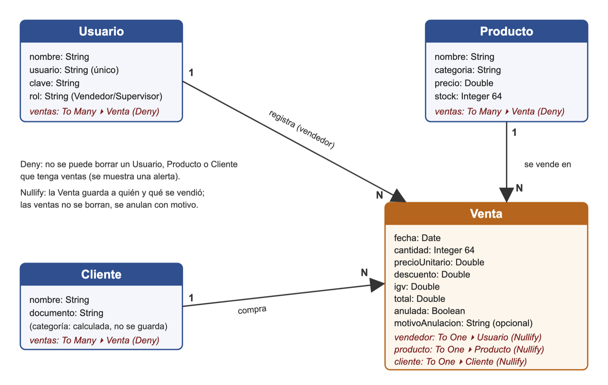

# Expediente del trabajo · Caso Ventas

## 1. Integrantes y caso

| Dato | Detalle |
|---|---|
| Curso | Programación en Móviles Avanzado · Semana 12 |
| Grupo y caso | Grupo A · Caso Ventas (UIKit + Core Data) |
| Nombre de la app | Ventas |
| Integrantes | Harold Salvador Zarate · …………………… · …………………… |
| Fecha | 08/11/2026 |

## 2. Modelo de datos

| Entidad | Atributos y tipos | Relaciones y delete rule |
|---|---|---|
| Usuario | nombre, usuario, clave (String); rol (String: Vendedor o Supervisor) | ventas: To Many ▸ Venta · Deny |
| Producto | nombre, categoria (String); precio (Double); stock (Integer 64) | ventas: To Many ▸ Venta · Deny |
| Cliente | nombre, documento (String). La categoría se calcula, no se guarda | ventas: To Many ▸ Venta · Deny |
| Venta | fecha (Date); cantidad (Integer 64); precioUnitario, descuento, igv, total (Double); anulada (Boolean); motivoAnulacion (String, opcional) | vendedor ▸ Usuario, producto ▸ Producto, cliente ▸ Cliente: To One · Nullify |

- Todos los atributos van en minúscula y se crean en el editor .xcdatamodeld (Codegen: Class Definition).
- Deny: Core Data no deja borrar un Usuario, Producto o Cliente con ventas; la app lo avisa con una alerta.
- Nullify en Venta: borrar una venta no borra a nadie. Las ventas no se borran: se anulan con motivo.

## 3. Roles y permisos

| Qué puede hacer | Vendedor | Supervisor |
|---|---|---|
| Pestañas | Productos, Clientes, Venta, Mis ventas, Cuenta | Resumen, Ventas, Productos, Clientes, Cuenta |
| Productos | Solo consultar y buscar | Crear, editar y borrar |
| Clientes | Crear, editar y consultar | Crear, editar, consultar y borrar |
| Ventas | Registrar y ver solo las suyas | Ver todas, filtrar por vendedor y anular con motivo |
| Resumen | No lo ve | Panel con indicadores, gráfico y ranking |
| Cuenta | Nombre, usuario, rol y Cerrar sesión | Nombre, usuario, rol y Cerrar sesión |

## 4. Reglas de negocio

| Regla | Cómo funciona | Ejemplo resuelto a mano |
|---|---|---|
| Categoría del cliente | Suma del total de sus ventas no anuladas: Regular < S/ 1,000; Frecuente desde S/ 1,000; VIP desde S/ 5,000. | Compras de 600.00 + 450.00 = 1,050.00 → Frecuente. Si se anula la de 450.00 queda 600.00 → Regular. |
| Descuento | VIP: 10 % del subtotal. Regular y Frecuente: 0 %. | VIP, 2 Laptop × 200.00: subtotal 400.00; descuento 400.00 × 0.10 = 40.00. |
| IGV y total | IGV = 18 % de (subtotal − descuento). Total = subtotal − descuento + IGV. Se redondea a 2 decimales. | (400.00 − 40.00) × 0.18 = 64.80; total 400.00 − 40.00 + 64.80 = 424.80. Regular, 3 Mouse × 35.00: 105.00; IGV 18.90; total 123.90. |
| Stock | Al registrar baja el stock. Si la cantidad supera el stock: alerta y no se registra. | Laptop con stock 40: venta de 2 → 38. Venta de 50 → alerta, stock sigue en 40. |
| Anular (supervisor) | Motivo obligatorio. Marca anulada = true, guarda el motivo, devuelve el stock y la venta deja de contar en reportes y en la categoría. | Anular la venta de 424.80: stock 38 + 2 = 40; el resumen y lo comprado por el cliente bajan 424.80. |
| Visibilidad | Vendedor: predicate "vendedor == %@" con el usuario de la sesión. Supervisor: todas las ventas. | Si hay 5 ventas y 2 son de lparedes, lparedes ve solo 2. |
| Usuario único | Fetch con "usuario ==[c] %@"; si devuelve algo, se rechaza. Clave de 6 o más y igual a su confirmación. | "lparedes" existe → "LPAREDES" se rechaza. Clave "1234" → error. |

## 5. Pantallas

Las nueve pantallas siguen la maqueta del laboratorio (A1 a A9). La pestaña Cuenta es sencilla: nombre, usuario, rol y Cerrar sesión.

| Pant. | Propósito | Lee | Escribe |
|---|---|---|---|
| A1 | Login | Usuario (usuario y clave) | Sesión: usuario actual |
| A2 | Registro | Usuario (¿ya existe?) | Usuario nuevo y sesión |
| A3 | Productos: búsqueda, chips de categoría, stock en color (verde > 10, ámbar 6–10, rojo ≤ 5) | Producto (predicate por nombre y categoría) | Producto (solo supervisor) |
| A4 | Clientes: iniciales, documento, total comprado y categoría | Cliente y sus ventas no anuladas | Cliente |
| A5 | Registrar venta: vendedor automático, cliente, producto, cantidad con stepper y resumen | Sesión, Cliente, Producto (stock) | Venta y Producto.stock |
| A6 | Mis ventas: indicadores hoy y mes, Todas / Hoy / Mes, búsqueda por cliente, anuladas tachadas | Venta con vendedor == sesión | — |
| A7 | Ventas del equipo: chips por vendedor, deslizar para Anular | Todas las Venta y Usuario | Abre A8 |
| A8 | Anulación: resumen de la venta, motivo obligatorio, botón Anular deshabilitado si no hay motivo | Venta | anulada, motivoAnulacion y Producto.stock |
| A9 | Resumen del supervisor: saludo, indicadores vs. día anterior, barras de 7 días, ranking del mes, stock bajo | Venta no anulada, Usuario y Producto | — |

## 6. Casos de prueba

| N.º | Caso | Resultado esperado |
|---|---|---|
| 1 | Registrar "lparedes" como Supervisor e intentar registrar "LPAREDES" | Se crea el primero y entra a la app; el segundo se rechaza por usuario repetido |
| 2 | Registrar con claves distintas o de 4 caracteres | Mensaje de error; no se crea el usuario |
| 3 | Login con clave incorrecta | "Usuario o clave incorrectos"; no entra |
| 4 | Vendedor vende 2 Laptop a S/ 200.00 a un cliente VIP | Subtotal 400.00 · descuento 40.00 · IGV 64.80 · total 424.80 · stock 40 → 38 |
| 5 | Vendedor vende 3 Mouse a S/ 35.00 a un cliente Regular | Subtotal 105.00 · IGV 18.90 · total 123.90 |
| 6 | Venta de 50 unidades con stock 40 | Alerta; no se registra; el stock no cambia |
| 7 | Un vendedor abre Mis ventas | Solo sus ventas; ninguna fila permite Anular |
| 8 | El supervisor anula la venta del caso 4 sin motivo y luego con motivo | Sin motivo no se puede; con motivo queda anulada, stock vuelve a 40 y el resumen baja 424.80 |
| 9 | Borrar un cliente que tiene ventas | Se impide y se muestra un mensaje |
| 10 (propio) | Rosa Díaz (Frecuente, S/ 4,720.00) compra 1 Monitor de S/ 300.00 y luego 1 Teclado de S/ 100.00 | Primera: sin descuento, IGV 54.00, total 354.00; lo comprado sube a 5,074.00 → VIP. Segunda: descuento 10.00, IGV 16.20, total 106.20 |
| 11 (propio) | Un vendedor inicia sesión y entra a Productos | Pestañas Productos, Clientes, Venta, Mis ventas y Cuenta; sin Resumen, sin botón + y sin deslizar para borrar |

## 7. Plan de commits

Un commit y push al terminar cada pantalla o regla, en la rama de la semana 12:

1. docs: expediente del Caso Ventas (este documento)
2. feat: proyecto Ventas con Core Data y modelo de 4 entidades
3. feat: A1 login y clase Sesion (static let compartido)
4. feat: A2 registro con usuario único y validación de clave
5. feat: pestañas por rol (UITabBarController) y pestaña Cuenta con Cerrar sesión
6. feat: A3 productos con búsqueda, chips, stock en color y borrado con Deny
7. feat: A4 clientes con total comprado y categoría calculada
8. feat: A5 registrar venta con stock, descuento e IGV
9. feat: A6 mis ventas con indicadores, periodo y búsqueda
10. feat: A7 ventas del equipo con filtro por vendedor
11. feat: A8 anulación con motivo y devolución de stock
12. feat: A9 resumen con gráfico de 7 días, ranking y stock bajo
13. chore: ícono y nombre "Ventas" en la pantalla de inicio
14. docs: casos de prueba con capturas y PROMPTS.md final

## 8. Plan de uso de IA

**A mano (rama manual):**

- Modelo de datos en el editor .xcdatamodeld, con atributos en minúscula y delete rules.
- Storyboard de inicio: Navigation Controller con el login (A1); las demás pantallas se arman en código con UIKit.
- Cálculo de descuento, IGV y total, comprobado a mano con los casos 4, 5 y 10.
- Registro, login y sesión, siguiendo las pistas del laboratorio.

**Con IA (rama ai-assisted):**

- Gráfico de barras de los últimos 7 días y ranking de vendedores (A9).
- Predicates de fechas (hoy, mes, últimos 7 días) y combinaciones con NSCompoundPredicate.
- Chips de categoría y de vendedor, y el estilo de las filas (stock en color, venta tachada).

**Cómo verificamos:**

- Cada consulta se anota en PROMPTS.md: Contexto, Tarea, Restricciones, Formato esperado y qué se hizo con la respuesta.
- Lo de la IA va en la rama ai-assisted y lo hecho sin ayuda en la rama manual.
- Toda respuesta se prueba con los 11 casos en el simulador y se compara con los cálculos a mano.
- No se sube código que no podamos explicar línea por línea en la defensa.

## 9. Visto bueno

| Dato | Detalle |
|---|---|
| Fecha |   |
| Firma o confirmación del docente |   |
| Observaciones |   |
