# Caso Ventas · Grupo A (UIKit + Core Data)

**Curso:** Programación en Móviles Avanzado · Semana 12
**Alumno:** Harold Salvador Zarate
**App:** Ventas (`Ventas/Ventas.xcodeproj`)

Una tienda registra productos, clientes y ventas. La app tiene login, registro, sesión y dos roles (Vendedor y Supervisor). Las pestañas del `UITabBarController` cambian según el rol.

- **Expediente** (modelo, permisos, reglas, pantallas, casos y planes): [EXPEDIENTE.md](EXPEDIENTE.md)

## Cómo ejecutar

1. Abrir `Ventas/Ventas.xcodeproj` en Xcode.
2. Elegir un simulador de iPhone y pulsar ▶︎ Run.
3. La primera vez se cargan datos de ejemplo:
   - vendedores `jperez` y `mrios`, con clave `123456`;
   - 8 productos;
   - 4 clientes;
   - 4 ventas de los últimos días.
4. Para entrar como supervisor, crea una cuenta con el rol Supervisor (por ejemplo `lparedes`, como en el caso 1).

La ruta del archivo SQLite sale en la consola de Xcode: `Base de datos SQLite en: ...`.

## Estructura del proyecto

| Carpeta | Archivos | Qué hace |
|---|---|---|
| `Ventas.xcdatamodeld` | Usuario, Producto, Cliente, Venta | Modelo en el editor, atributos en minúscula, Deny y Nullify |
| `Logica/` | `Calculo.swift` | Categoría del cliente, descuento, IGV y total |
| | `Datos.swift` | Fetch requests con `NSPredicate`, registrar venta, anular, borrar |
| | `Sesion.swift` | `static let shared`: usuario conectado, iniciar y cerrar sesión |
| | `DatosEjemplo.swift` | Datos iniciales si la base está vacía |
| `Base.lproj/Main.storyboard` | Las 9 pantallas del caso: A1 a A9 | Diseño de cada pantalla, celdas, outlets y actions; segues A1 → A2 y A7 → A8 |
| `Base.lproj/LaunchScreen.storyboard` | Logo y nombre | Pantalla que iOS muestra mientras abre la app |
| `Pantallas/` | `LoginViewController` (A1), `RegistroViewController` (A2) | Inicio de sesión y registro |
| | `ProductosViewController` (A3), `ClientesViewController` (A4) | Catálogos; crear y editar con una alerta de campos |
| | `NuevaVentaViewController` (A5), `MisVentasViewController` (A6) | Pantallas del vendedor |
| | `VentasEquipoViewController` (A7), `AnulacionViewController` (A8), `ResumenViewController` (A9) | Pantallas del supervisor |
| | `PestanasPorRol` | Arma las pestañas por código según el rol, con las pantallas del storyboard |
| | `CuentaViewController` | Pestaña Cuenta (por código): nombre, usuario, rol y Cerrar sesión |
| `Componentes/` | Chips, gráfico de barras, insignias, formato | Piezas de interfaz reutilizables |

## Reglas de negocio

- **Categoría del cliente** (calculada con las ventas no anuladas):
  - Regular: menos de S/ 1,000.
  - Frecuente: desde S/ 1,000.
  - VIP: desde S/ 5,000.
- **Descuento:** VIP 10 % del subtotal; los demás 0 %.
- **IGV:** 18 % de (subtotal − descuento).
- **Total:** subtotal − descuento + IGV.
- **Stock:**
  - Al registrar una venta, el stock baja.
  - Si la cantidad supera el stock, sale una alerta y la venta no se registra.
- **Anular (solo supervisor):**
  - Exige un motivo.
  - Marca la venta como anulada y devuelve el stock.
  - La venta deja de contar en reportes y en la categoría del cliente.
- **Visibilidad:** el vendedor solo ve sus ventas (`vendedor == %@`); el supervisor ve todas.
- **Borrado:** con la delete rule **Deny**, Core Data no deja borrar un producto, cliente o usuario que tenga ventas. La app lo avisa con una alerta.

## Casos de prueba

Los 11 casos se probaron en el simulador del iPhone SE (3.ª generación) con una prueba automática de interfaz (XCUITest). La prueba pasó completa. Al final cierra la app y la vuelve a abrir para comprobar que los datos se guardan.

| N.º | Caso | Resultado obtenido | Captura |
|---|---|---|---|
| 1 | Registrar `lparedes` (Supervisor) y luego `LPAREDES` | El primero entra a la app. El segundo se rechaza: "Ese usuario ya existe" | [registro](capturas/06_caso1_registro_lparedes.jpg) · [entra](capturas/07_caso1_lparedes_entra.jpg) · [rechazado](capturas/09_caso1_LPAREDES_rechazado.jpg) |
| 2 | Clave de 4 caracteres, y claves distintas | "La clave debe tener al menos 6 caracteres" y "Las claves no coinciden"; no se crea el usuario | [clave corta](capturas/04_caso2_clave_corta.jpg) · [claves distintas](capturas/05_caso2_claves_distintas.jpg) |
| 3 | Login con clave incorrecta | "Usuario o clave incorrectos"; no entra | [captura](capturas/02_caso3_clave_incorrecta.jpg) |
| 4 | 2 Laptop × S/ 200.00 a Comercial Andina SAC (VIP) | Subtotal 400.00 · descuento 40.00 · IGV 64.80 · total 424.80 · stock 40 → 38 | [resumen](capturas/15_caso4_resumen_vip.jpg) · [registrada](capturas/16_caso4_venta_registrada.jpg) |
| 5 | 3 Mouse × S/ 35.00 a María López (Regular) | Subtotal 105.00 · IGV 18.90 · total 123.90 | [captura](capturas/17_caso5_resumen_regular.jpg) |
| 6 | 50 Laptop con stock 40 | Alerta "Solo hay 40 unidades de Laptop"; no se registra y el stock no cambia | [captura](capturas/14_caso6_stock_insuficiente.jpg) |
| 7 | El vendedor abre Mis ventas | Solo ve sus ventas (la de Marta Ríos no aparece) y ninguna fila tiene Anular | [captura](capturas/20_caso7_A6_mis_ventas.jpg) |
| 8 | El supervisor anula la venta del caso 4, primero sin motivo y luego con motivo | Sin motivo, Anular está deshabilitado. Con motivo, la venta queda ANULADA, el stock vuelve a 40 y el resumen de hoy baja de 1,008.90 a 584.10 (− 424.80) | [sin motivo](capturas/27_caso8_A8_sin_motivo.jpg) · [anulada](capturas/29_caso8_venta_anulada.jpg) · [stock](capturas/30_caso8_stock_vuelve_40.jpg) · [resumen](capturas/31_caso8_A9_resumen_despues.jpg) |
| 9 | Borrar a Carlos Vega, que tiene ventas | Alerta "No se puede borrar"; el cliente sigue en la lista | [captura](capturas/32_caso9_cliente_con_ventas.jpg) |
| 10 (propio) | Rosa Díaz (Frecuente, 4,720.00) compra 1 Monitor y luego 1 Teclado | Monitor: IGV 54.00, total 354.00. Pasa a VIP (5,074.00). Teclado: descuento 10.00, IGV 16.20, total 106.20 | [monitor](capturas/18_caso10_frecuente_monitor.jpg) · [teclado](capturas/19_caso10_ahora_vip_teclado.jpg) · [VIP](capturas/22_caso10_rosa_vip.jpg) |
| 11 (propio) | Un vendedor entra a Productos | Pestañas Productos, Clientes, Venta, Mis ventas y Cuenta; sin Resumen, sin botón + y sin deslizar para borrar | [captura](capturas/10_caso11_A3_productos_vendedor.jpg) |

## Pantallas

| A1 Login | A2 Registro | A3 Productos | A4 Clientes | A5 Venta |
|---|---|---|---|---|
| 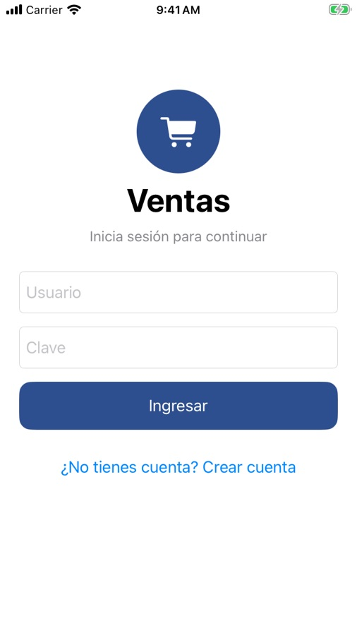 | 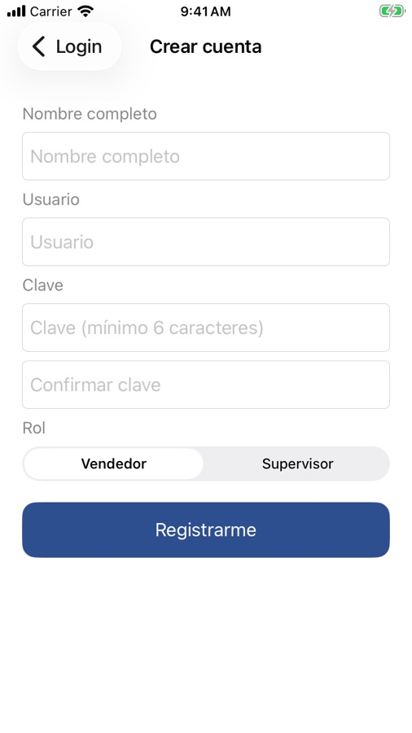 | 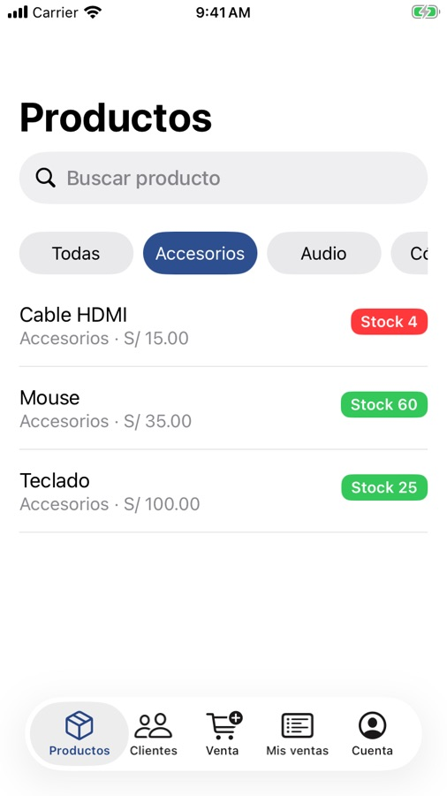 | 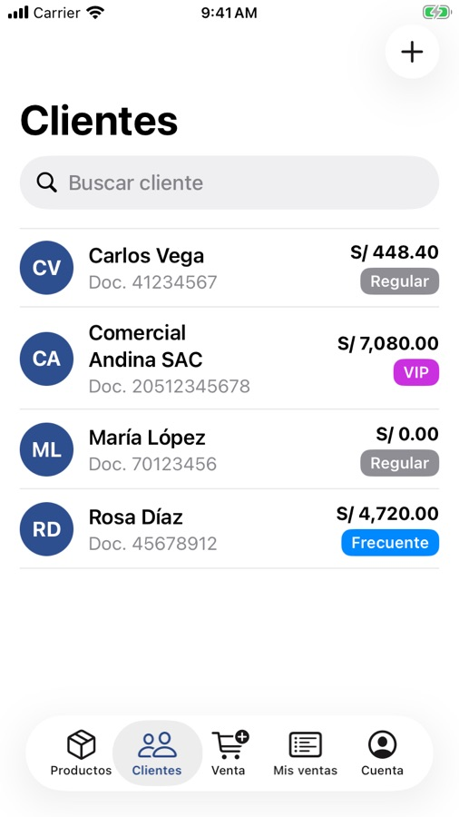 | 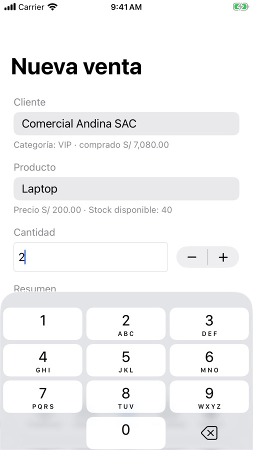 |

| A6 Mis ventas | A7 Ventas del equipo | A8 Anulación | A9 Resumen | Cuenta |
|---|---|---|---|---|
| 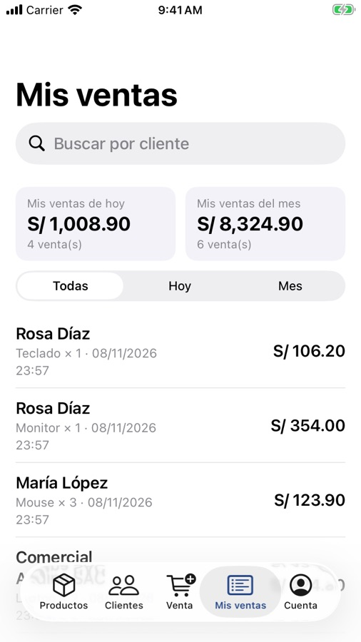 | 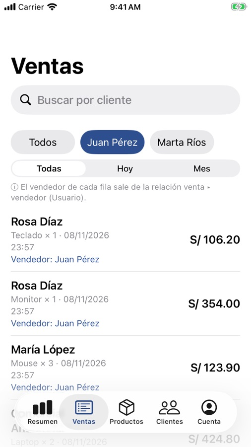 | 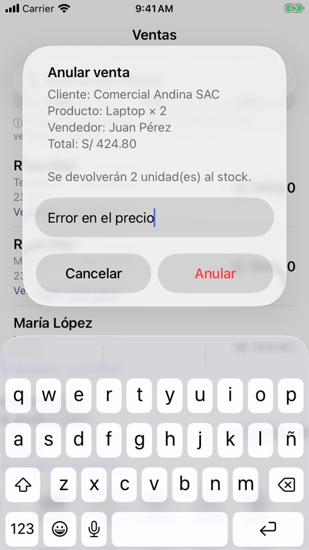 | 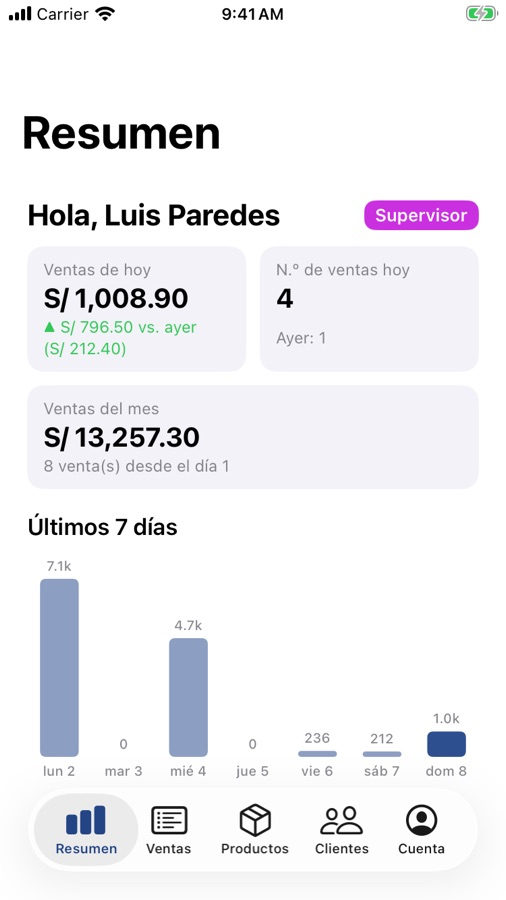 | 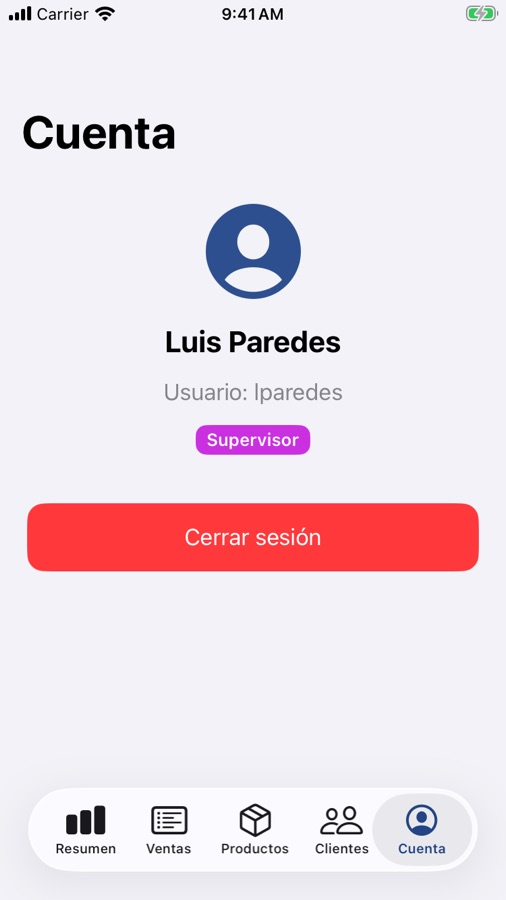 |

**Ícono y nombre "Ventas" en la pantalla de inicio:**

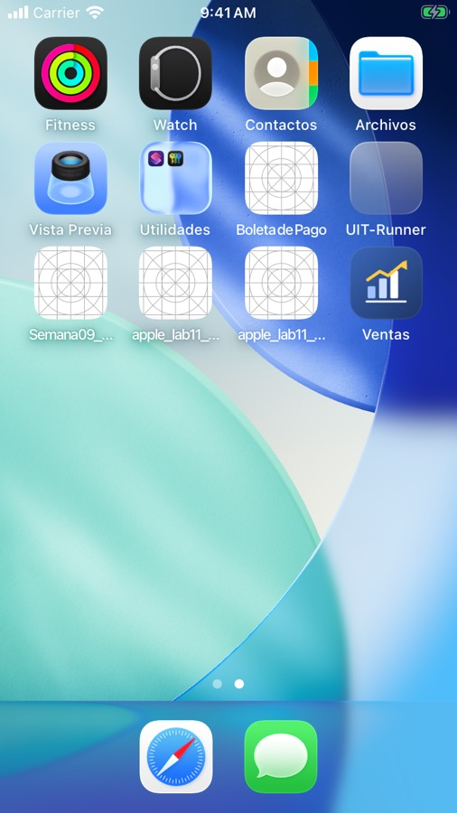

## Conclusiones

1. Las delete rules son reglas de negocio:
   - **Deny** protege el historial: no se puede borrar un cliente, producto o vendedor con ventas.
   - **Nullify** en Venta permite guardar quién vendió, qué y a quién.
2. Un `NSPredicate` resuelve la visibilidad por rol (`vendedor == %@`), el periodo (`fecha >= %@`) y la búsqueda (`cliente.nombre CONTAINS[cd] %@`). La base de datos filtra antes de que los datos lleguen a la pantalla.
3. Guardar los montos en la venta (descuento, IGV y total) y calcular la categoría del cliente al momento permite anular sin perder el historial. Por eso la categoría puede subir, como en el caso 10, o bajar cuando se anula una venta.
